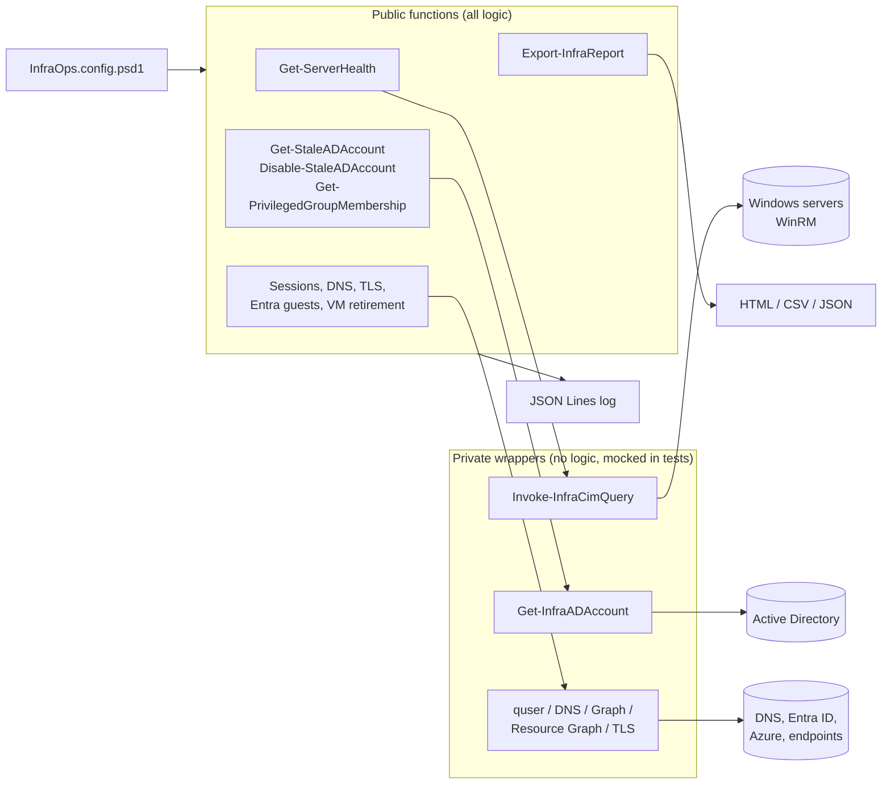
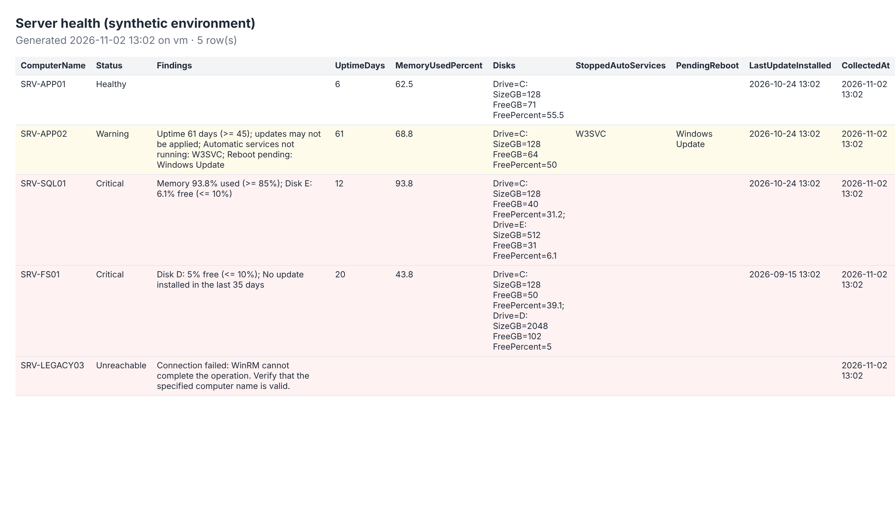

# Enterprise Infrastructure Automation

A PowerShell 7 module (`InfraOps`) for recurring infrastructure audits: Windows Server health, stale and privileged Active Directory accounts, idle remote sessions, DNS consistency, TLS certificate expiry, Entra ID guest access, and Azure VM series retirements. Output is structured objects, logging is structured, and the module is read-only by default. It ships with 72 Pester tests that run on any OS against synthetic data.

| | |
|---|---|
| Project type | Independently built module. Some functions generalize work done professionally (VM retirement audits, health reporting); no employer code or data is included. |
| Local validation | 72/72 Pester tests, 75.8% command coverage, PSScriptAnalyzer clean ([evidence](docs/validation/README.md)) |
| Field validation | Not yet run against real servers, AD, Entra ID, or Azure |

## Scenario: what's real and what this repo adds

Real work at an MSP:
- Audited VMs across the client base affected by Azure VM series retirements and price changes, so clients could be notified with an upgraded series recommended for each VM.
- Wrote a PowerShell SQL Server health check, published separately as [PowerShell-SQL-HealthCheck](https://github.com/RaeRucker/PowerShell-SQL-HealthCheck).

Added for this repo:
- `Get-AzVmRetirementReport` rewrites the retirement audit as a reusable module function with a data-driven retirement map. It is not the script used at work.
- `Get-ServerHealth` follows the same idea as the SQL health check, applied to Windows Server.
- The Active Directory, privileged group, remote session, DNS, TLS, and Entra ID guest functions, the module structure, the logging, and the Pester tests were built for this repo.

## Problem

Recurring checks (low disk, stopped services, stale accounts, expiring certificates, inconsistent DNS) are usually separate scripts with hardcoded thresholds, inconsistent output, no tests, and destructive steps without safeguards. When one fails partway, the whole run produces nothing. When someone runs a cleanup script against the wrong OU, there's no confirmation and no audit trail.

## Functions

| Function | Purpose | Changes state |
|---|---|---|
| `Get-ServerHealth` | Uptime, memory, disk, stopped automatic services, pending reboot, patch age | No |
| `Get-StaleADAccount` | Enabled users or computers inactive N days (replication-aware) | No |
| `Disable-StaleADAccount` | Disable, annotate, and optionally quarantine reviewed accounts | Yes: `-WhatIf`, High confirm impact, `-MaxCount`, service-account guard |
| `Get-PrivilegedGroupMembership` | Nested membership of privileged groups, with risk flags | No |
| `Get-RemoteSessionAudit` | RDP and console sessions; flags long-idle disconnected sessions | No |
| `Test-DnsConsistency` | Same name against several DNS servers; flags disagreement or unexpected answers | No |
| `Get-TlsCertificateExpiry` | The certificate an endpoint actually presents: expiry, name mismatch, trust | No |
| `Get-EntraGuestAccessReport` | Guests classified as pending, never signed in, stale, or active | No |
| `Get-AzVmRetirementReport` | VMs on retiring series across tenants, with replacements | No |
| `Export-InfraReport` | HTML (encoded), CSV, or JSON from any output | Writes a file (`-WhatIf`) |
| `Get-InfraOpsConfig` | Thresholds and settings from a data file, with safe defaults | No |

## Architecture



Why this shape: [ADR 0001](docs/decisions/0001-module-design.md).

## Example output

Generated by [`examples/New-ExampleOutput.ps1`](examples/New-ExampleOutput.ps1), which runs the real functions against a synthetic environment. All names are fictional.



The run shows each status: a healthy server, a warning (uptime, a stopped service, a pending reboot), two criticals (memory and disk), and an unreachable host that's reported, not fatal. CSV and TLS examples are in [`examples/output/`](examples/output/).

## Usage

```powershell
Import-Module ./src/InfraOps/InfraOps.psd1
Get-InfraOpsConfig -Path ./config/InfraOps.config.psd1 | Out-Null   # optional; defaults are safe

# Health of every server in an OU, problems only
Get-ADComputer -SearchBase 'OU=Servers,DC=corp,DC=example' -Filter * |
    Get-ServerHealth | Where-Object Status -ne 'Healthy' |
    Export-InfraReport -Path ./output/health.html -Title 'Servers needing attention'

# Stale computers: review first, then disable with confirmation
$stale = Get-StaleADAccount -Type Computer -InactiveDays 120
$stale | Export-InfraReport -Path ./output/stale-computers.csv
$stale | Disable-StaleADAccount -QuarantineOU 'OU=Disabled,DC=corp,DC=example' -WhatIf

# Certificates that clients will see expire
Get-TlsCertificateExpiry -Endpoint portal.example.com, dc01.corp.example:636 | Where-Object Status -ne 'OK'

# Do all domain controllers agree on a record?
Test-DnsConsistency -Name app.corp.example -Server 10.0.0.4, 10.0.0.5 -Expected @{ 'app.corp.example' = '10.1.2.10' }
```

Every function has full comment-based help (`Get-Help Get-ServerHealth -Full`). The tests check that each exported function has a synopsis, a description, and an example.

### Scheduled run

[`scripts/Invoke-DailyInfraCheck.ps1`](scripts/Invoke-DailyInfraCheck.ps1) runs health, TLS, and DNS checks from the config, writes the reports, enforces retention, and exits `0`, `1`, or `2` (healthy, warning, critical) so a scheduler or monitoring system can alert on it. Task registration with a gMSA is in its help.

## Configuration

[`config/examples/InfraOps.config.psd1`](config/examples/InfraOps.config.psd1) has thresholds, ignored services, privileged groups, logging path, and daily-check targets. Copy it to `config/InfraOps.config.psd1`, which is git-ignored.

## Engineering decisions and tradeoffs

| Decision | Reason | Tradeoff |
|---|---|---|
| Wrappers around every external call | Logic is testable on any OS without credentials | Wrappers themselves need field testing |
| Partial failure returned as data | One bad server doesn't hide results for 200 others | Callers must check `Status`, not just catch exceptions |
| Disable, never delete | Reversible. Deletion is a separate, later decision after a retention period. | Disabled accounts need a second cleanup process |
| `lastLogonTimestamp` instead of querying every DC's `lastLogon` | One query, replicated value | Up to about 14 days of lag; minimum window enforced and documented |
| Check the TLS certificate *presented*, not the store | That's what breaks clients (wrong binding, intermediate missing) | Needs network access to each endpoint |
| Parse `quser` by header column positions | `SESSIONNAME` is blank for disconnected sessions, so whitespace splitting misreads them | Depends on English column headers (documented) |

## Security

Least-privilege rights per function, safeguards, and threats considered: [docs/security.md](docs/security.md).

## Testing

```powershell
Invoke-Pester ./tests -Output Detailed
Invoke-ScriptAnalyzer -Path ./src -Recurse
```

CI ([`.github/workflows/ci.yml`](.github/workflows/ci.yml)) runs the analyzer, Pester on Windows and Linux with coverage, and a secret scan.

## Limitations and known gaps

- Not yet run against real infrastructure. The parsing and classification logic is tested, but the wrappers aren't.
- `Get-RemoteSessionAudit` relies on `quser.exe` output, which is localized on non-English Windows.
- `Get-ServerHealth` uses CIM over WinRM. Servers reachable only over DCOM aren't supported.
- No built-in email or Teams delivery. The exit codes and files are meant to feed an existing scheduler or monitoring pipeline.

## Future improvements

1. Field-test against a lab domain (Windows Server 2022/2025 VMs) and publish sanitized sample runs.
2. Add `Get-BackupJobStatus` for Azure Backup and MABS using the same pattern.
3. Publish to a private PowerShell repository with versioned releases from CI.
4. Add a `-AsJob` / `ForEach-Object -Parallel` mode for large server lists.

## Repository structure

```text
enterprise-infrastructure-automation/
├── src/InfraOps/
│   ├── InfraOps.psd1 / InfraOps.psm1
│   ├── Public/      11 exported functions
│   ├── Private/     logging, CIM, AD, quser, object helpers
│   └── Data/        vm-retirement-map.json
├── tests/           InfraOps.Tests.ps1 (72 tests), fixtures/, analyzer settings
├── config/examples/ InfraOps.config.psd1
├── scripts/         Invoke-DailyInfraCheck.ps1
├── examples/        New-ExampleOutput.ps1, output/
├── docs/            security.md, decisions/, validation/, images/
└── .github/workflows/ci.yml
```
